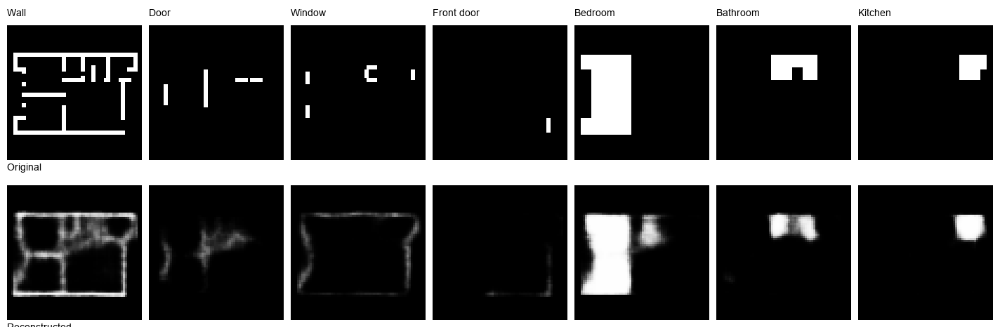
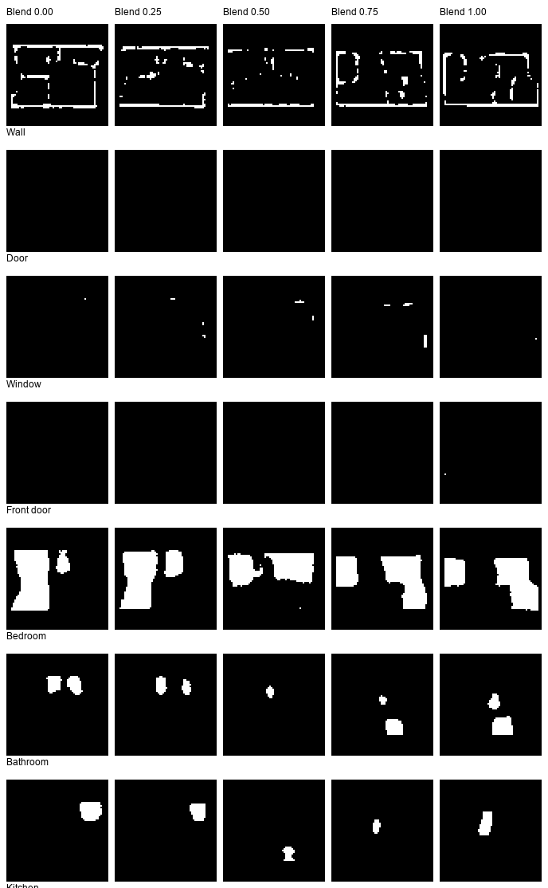

# 01 · Autoencoder

**Hugging Face model:** https://huggingface.co/iaac-maai/hackathon-team4-resplan-ae

A Conditional Variational Autoencoder (CVAE) trained on residential floor plans from ResPlan. The full description is in the [root README](../README.md).

## Use case

**VAE blend (latent interpolation):** two floor plans are encoded into latent vectors. The steps between the two vectors are decoded into new floor-plan representations, which can be used to explore variations of residential layouts.

## Dataset

| | |
|---|---|
| **Name** | ResPlan |
| **Size** | about 17,000 residential floor plans |
| **Source** | https://github.com/dariabasha/ResPlan (fork of the original release, https://www.kaggle.com/datasets/resplan/resplan) |
| **Licence** | see the [root README](../README.md#data) |
| **Input** | 14 geometry channels, rasterised to 64 × 64 px, plus 3 conditions (net area, area, wall depth) |

The data is not in this repository. Put `ResPlan.pkl` in the `data/` folder at the root.

## Training notebooks and deployed models

The Monday CVAE results documented here come from [`notebook/02_autoencoder_clean_audited.ipynb`](notebook/02_autoencoder_clean_audited.ipynb). The executed layout-model training notebook is [`notebook/04_layout_generator.ipynb`](notebook/04_layout_generator.ipynb); it contains the v1 baseline. The checked-in server configuration identifies the deployed artifact as LayoutCVAE v2, and `02_server/publish.py` exports a decoder to ONNX. The v2 source weights and per-epoch training history are not present in this checkout, so the baseline notebook's loss plot must not be read as the deployed v2 history or as a reproducible source for that artifact.

Open the relevant notebook in Jupyter or VS Code and run its cells in order. The ResPlan dataset and model checkpoints are not included in this repository. The unrun v2/v3 experiment notebooks were removed rather than presented as completed experiments.

## Setups compared (same split)

| Model | Latent dimension | Parameters | Test objective | Reconstruction loss | KL divergence |
|---|---:|---:|---:|---:|---:|
| CVAE_z32 | 32 | 1.92M | 205.52 | 205.51 | 7.21 |
| **CVAE_z64** | 64 | 2.32M | **187.84** | 187.82 | 15.88 |
| CVAE_z128 | 128 | 3.11M | 196.96 | 196.94 | 22.79 |

CVAE_z64 has the lowest test objective. A bigger latent space (z128) did not improve the result.

## Results

More figures (training curves for all three setups) are in the [root README](../README.md#5-visual-results) and in [`figures/`](figures/).

The three curves above compare Monday CVAE variants only; the app's separate layout-model metrics and artifacts are documented in the [root README](../README.md#the-model-behind-sketcheat) and [`PIPELINE.md`](../PIPELINE.md).

## Limitations

- Reconstructed plans are blurry; doors, windows and walls can be incomplete.
- Generated layouts are not checked against building rules or functional needs.
- The output is a raster image, not editable CAD or BIM geometry.
