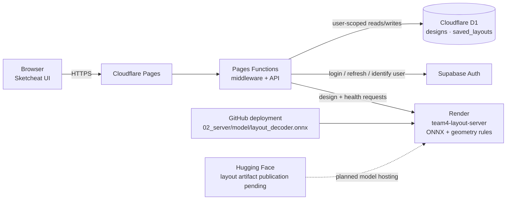
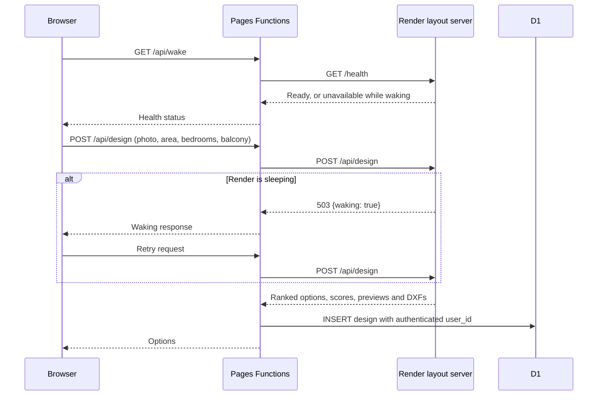
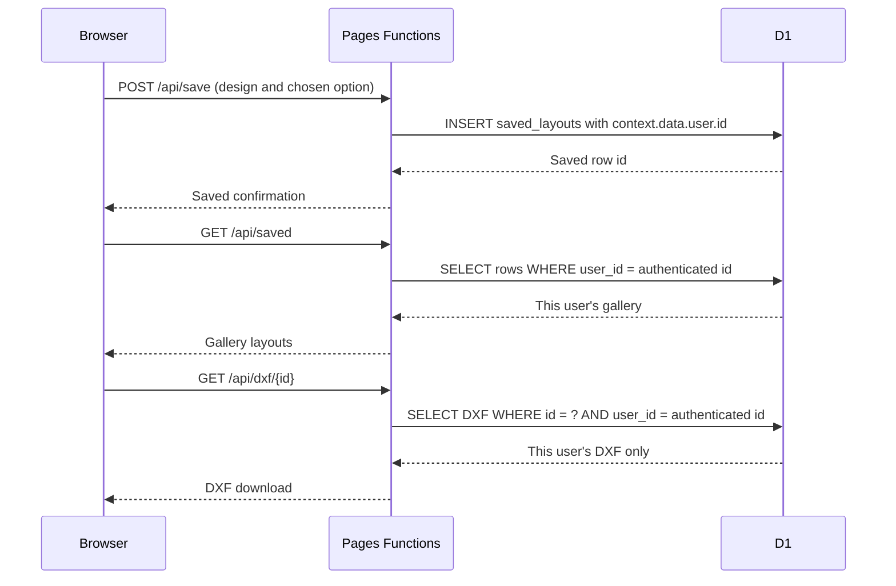

# Wednesday app diagrams

These diagrams describe the app that was built, not an aspirational Cloudflare Access/team-password design. The app uses Supabase Auth and individual email/password accounts.

## User stories

1. **Generate options:** As an architect exploring an early design, I want to photograph a flat outline and specify area, bedrooms and balcony, so I can compare generated layout options.
2. **Keep and export a design:** As a logged-in user, I want to save a candidate to my gallery, edit its rooms and download its DXF, so I can revisit and continue working with it.

## System



The Hugging Face arrow is a planned artifact-hosting path, not a live dependency. The Render service currently loads the checked-in ONNX file. There is no team-password cookie, Cloudflare Access gate or R2 bucket.

## Sequences

### 1. Sign up or log in

```mermaid
sequenceDiagram
  participant B as Browser
  participant F as Pages Functions
  participant M as Middleware
  participant S as Supabase Auth
  B->>F: POST /api/login (email, password, mode)
  F->>S: /auth/v1/signup or /auth/v1/token
  S-->>F: Auth session
  F-->>B: Set HttpOnly session cookies; redirect
  B->>M: Request protected page or API
  M->>S: GET /auth/v1/user (access cookie)
  S-->>M: User id and email
  M-->>F: Continue with context.data.user
```

### 2. Wake the server and generate layouts



### 3. Save, view and download


