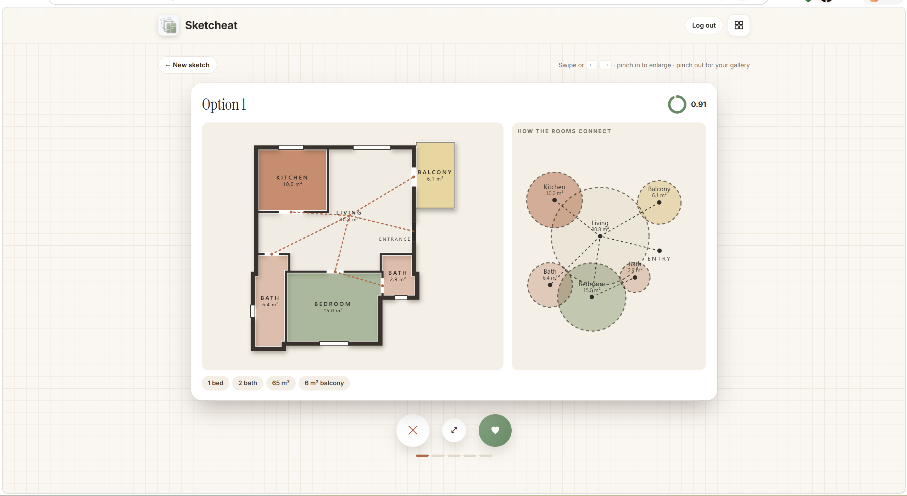
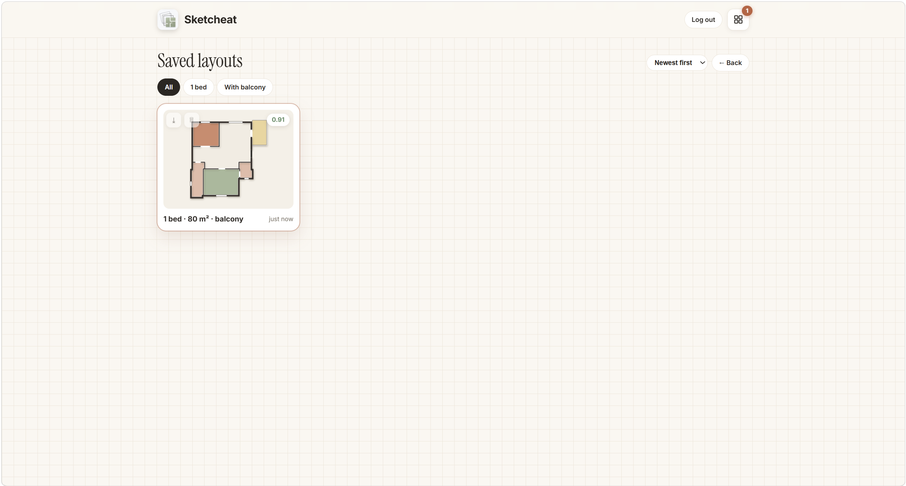

# PROOFS · Sketcheat (Team 4)

Live app: https://sketcheat-team4.pages.dev (test account: in the course hand-in, never in this repo)
Model: https://team4-layout-server.onrender.com (`/health`)

For each proof: the command, then a screenshot of its output in `04_final/proofs/`.
On Windows PowerShell type `curl.exe`, not `curl`.

## 1 · A database

```powershell
cd 03_app
npx wrangler d1 execute DB --remote --command "SELECT name, sql FROM sqlite_master"
npx wrangler d1 execute DB --remote --command "SELECT COUNT(*) FROM designs"
npx wrangler d1 execute DB --remote --command "SELECT id, created_at, bedrooms, area_m2 FROM designs ORDER BY created_at DESC LIMIT 5"
```
Expected: tables `designs` and `saved_layouts`, and at least one saved row.


## 2 · Protected API

```powershell
curl.exe -i https://sketcheat-team4.pages.dev/api/saved
```
Expected: `401` and `{"error":"Not logged in"}` without a valid Supabase session.


## 3 · Connected to Render

One live result in the app, plus our `MODEL_URL` line:

```powershell
Select-String MODEL_URL 03_app\wrangler.toml
```
Expected: `MODEL_URL = "https://team4-layout-server.onrender.com"`


## 4 · No secrets in git

```powershell
Select-String "dev.vars" .gitignore
git log --all --oneline -- 03_app/.dev.vars
```
Expected: `.dev.vars` is listed, and the log prints nothing (it was never committed).
Plus the answer to the agent prompt "Check my repo and my Cloudflare account for secrets that are in code or in the git history."


## 5 · Generated layout

The app screenshot shows a generated layout option with its score and room diagram.



## 6 · Own data only

Saved rows include an owner id. The gallery screenshot shows the saved-layout view.

```powershell
npx wrangler d1 execute DB --remote --command "SELECT user_id, COUNT(*) FROM saved_layouts GROUP BY user_id"
```



## Optional item

- [x] Privacy page: https://sketcheat-team4.pages.dev/privacy (public, no login needed)
