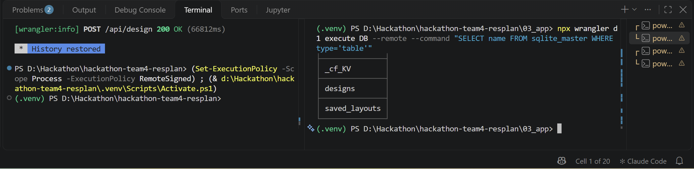
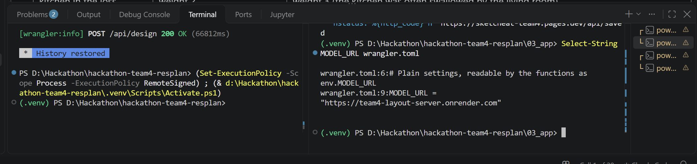
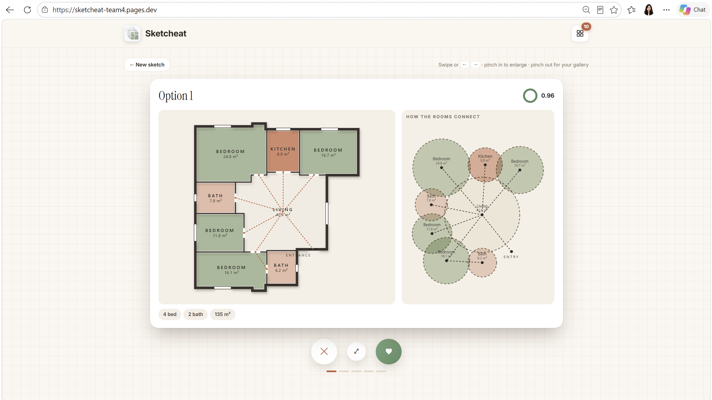
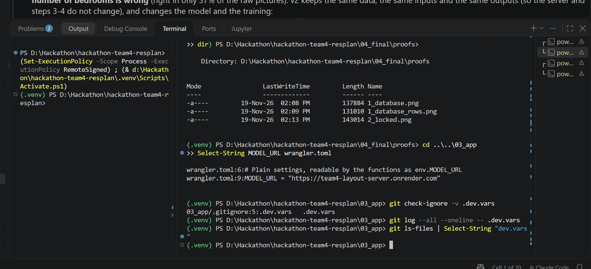

# PROOFS · Sketcheat (Team 4)

Live app: https://sketcheat-team4.pages.dev (test account: in the course hand-in, never in this repo)
Model: https://team4-layout-server.onrender.com (`/health`)

For each proof: the command, then a screenshot of its output in `04_final/proofs/`.
On Windows PowerShell type `curl.exe`, not `curl`.

## 1 · A database

```powershell
cd 03_app
npx wrangler d1 execute DB --remote --command "SELECT name, sql FROM sqlite_master"
npx wrangler d1 execute DB --remote --command "SELECT COUNT(*) FROM designs"
npx wrangler d1 execute DB --remote --command "SELECT id, created_at, bedrooms, area_m2 FROM designs ORDER BY created_at DESC LIMIT 5"
```
Expected: tables `designs` and `saved_layouts`, and at least one saved row.



## 2 · Locked on the server

```powershell
curl.exe -i https://sketcheat-team4.pages.dev/api/saved
```
Expected: `401` and `{"error":"Not logged in"}`, not our data.



## 3 · Connected to Render

One live result in the app, plus our `MODEL_URL` line:

```powershell
Select-String MODEL_URL 03_app\wrangler.toml
```
Expected: `MODEL_URL = "https://team4-layout-server.onrender.com"`



## 4 · No secrets in git

```powershell
Select-String "dev.vars" .gitignore
git log --all --oneline -- 03_app/.dev.vars
```
Expected: `.dev.vars` is listed, and the log prints nothing (it was never committed).
Plus the answer to the agent prompt "Check my repo and my Cloudflare account for secrets that are in code or in the git history."



## 5 · Accounts work

Screenshots: create an account → logged in (email shown top right) → Log out → back on the login page.
Also: log in with a wrong password → "Wrong email or password."

  

## 6 · Own data only

User A saves layouts. User B logs in (other browser or private window): B's gallery is empty and A's DXF link gives `Not found`.
In the database, every saved row has an owner:

```powershell
npx wrangler d1 execute DB --remote --command "SELECT user_id, COUNT(*) FROM saved_layouts GROUP BY user_id"
```

 

## Optional item

- [x] Privacy page: https://sketcheat-team4.pages.dev/privacy (public, no login needed)
