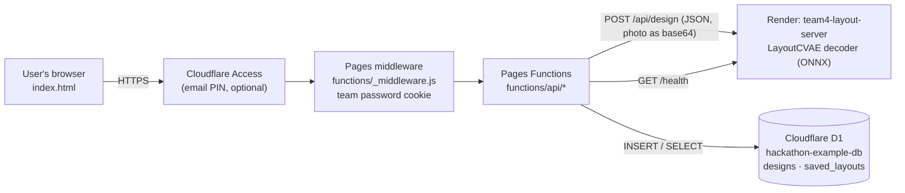

# 1 · System diagram: Sketcheat (Team 4)

Every box and arrow below exists in our code (`03_app/` and the Render server).

| Arrow | Code |
|---|---|
| Browser → Functions | `fetch("/api/design")`, `/api/wake`, `/api/save`, `/api/saved`, `/api/dxf/<id>` in `public/index.html` |
| Login | `functions/api/login.js` → Supabase `/auth/v1/signup` or `/auth/v1/token`, sets HttpOnly cookies `sb_access` + `sb_refresh` |
| Who is this? | `functions/_middleware.js` → Supabase `/auth/v1/user` on every request, puts the user id in `data.user` |
| Functions → Render | `fetch(env.MODEL_URL + "/api/design")` in `functions/api/design.js`, `/health` in `functions/api/wake.js` |
| Functions → D1 | `env.DB.prepare(...)` in `design.js` (table `designs`), `save.js`, `saved.js`, `dxf/[id].js` (table `saved_layouts`). Every query has `WHERE user_id = ?` with the id from the session |

No R2: the sketch thumbnail (200 px JPEG) is stored as text in D1.
