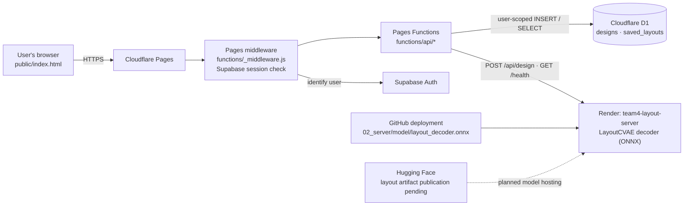

# 1 · System diagram: Sketcheat (Team 4)

Every solid box and arrow below exists in our code (`03_app/` and the Render server). The Hugging Face arrow is a planned artifact-hosting path and is not live yet.

| Arrow | Code |
|---|---|
| Browser → Pages Functions | `fetch("/api/design")`, `/api/wake`, `/api/save`, `/api/saved`, `/api/dxf/<id>` in `public/index.html` |
| Login | `functions/api/login.js` → Supabase `/auth/v1/signup` or `/auth/v1/token`, sets HttpOnly cookies `sb_access` + `sb_refresh` |
| Who is this? | `functions/_middleware.js` → Supabase `/auth/v1/user` on protected requests, puts the user id in `data.user` |
| Functions → Render | `fetch(env.MODEL_URL + "/api/design")` in `functions/api/design.js`, `/health` in `functions/api/wake.js` |
| Functions → D1 | `env.DB.prepare(...)` in `design.js` (table `designs`), `save.js`, `saved.js`, `dxf/[id].js` (table `saved_layouts`). Saved-layout reads/writes use the session user id |
| Render model artifact | Render uses the checked-in `02_server/model/layout_decoder.onnx`; Hugging Face hosting is not yet configured |

There is no team-password cookie or Cloudflare Access gate: visitors create an individual Supabase email/password account. No R2 is used; the sketch thumbnail and saved DXF are stored in D1.
