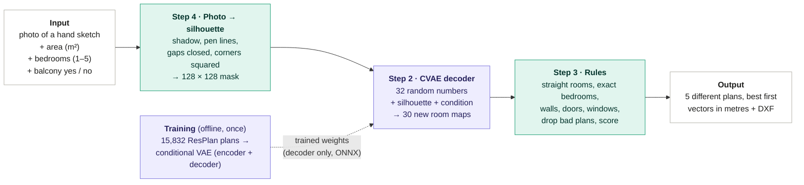

# Layout generator: how a sketch becomes 5 floor plans

Team 4 · IAAC MaAI · AI Methods hackathon, November 2026

The user draws the silhouette of a flat, takes a photo, and types the area, the number of bedrooms and balcony yes/no. The app answers with 5 floor plans (vectors in metres + DXF).

**Purple = learned from data (the model). Green = fixed rules and image processing.**

## What the model invents (learned from data)

- **The zoning:** where the living room, bedrooms, bathrooms, kitchen and balcony go inside the drawn silhouette.
- **Room sizes** and which rooms sit next to each other.
- **Other random numbers → another plan** for the same silhouette. The "Show other options" button on the test page does this.
- **Nothing is looked up:** the server holds no ResPlan plan, only the model file (`02_server/model/layout_decoder.onnx`, 3 MB). A hand-drawn silhouette is not in the data at all.

## What fixed rules do (not learned)

- **Straight walls:** the zoning is cut into rectangles.
- **The exact number of bedrooms:** the raw model is right 37% of the time (±1 bedroom in 86%), so step 3 splits or rejects.
- **Walls** (20 cm outside, 10 cm inside), **doors, windows, entrance.**
- **Drop the plans that break the rules** (bedroom ≥ 9 m², one kitchen, a main bathroom ≥ 3.5 m²…), then keep the 5 best that differ from each other by at least 25%.

In one sentence: **the model invents the zoning, and the rules turn it into a clean plan.** It is not a search in the data, and it is not a model that outputs a finished DXF by itself.

## Where each step is

| Step | What | Code |
|---|---|---|
| Training | room maps from ResPlan, conditional VAE | `01_autoencoder/notebook/04_layout_generator.ipynb` |
| Step 2 + 3 | the model's pictures → clean vector plans | `01_autoencoder/notebook/05_layout_to_vector.ipynb` (figure 50 shows the raw model output next to the final plan) |
| Step 4 | photo → silhouette, and the whole app end to end | `01_autoencoder/notebook/06_photo_to_silhouette.ipynb` |
| All steps | shared code | `01_autoencoder/notebook/layout_core.py` |
| The app | model server (API + test page) | `02_server/` |
