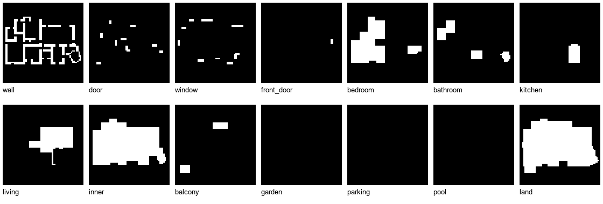

# hackathon-team4-resplan

IAAC MaAI – AI Methods hackathon, 16–20 November 2026.

## Team

- Team 4: Fawad, Hetashree, Daria, Luis

## Links

| Part | Where |
|---|---|
| Autoencoder (Monday) | [`01_autoencoder/`](01_autoencoder/) · model on Hugging Face: https://huggingface.co/iaac-maai/hackathon-team4-resplan-ae |
| Model server (Tuesday) | [`02_model_server/`](02_model_server/) · live: https://team4-resplan-server.onrender.com |

## Model server

A Gradio server on Render (free plan, Frankfurt), with a page for people and an API for programs. Code and API examples: [`02_model_server/`](02_model_server/).

- **`/search`**: bedrooms and floor area (sqft) in, the 6 closest ResPlan plans out, each with its room counts, 8 × 8 relationship matrix and scores (circulation, daylight, cross-ventilation, dark rooms, missing door).
- **`/predict`**: the course's class example model (Fashion-MNIST anomaly autoencoder). It is a placeholder until our own model is on the server.

The free service sleeps after 15 minutes without requests; the first call then takes about one minute.

# ResPlan — Conditional Variational Autoencoder

## 1. Project Overview

This project explores the application of generative AI to residential floor-plan design using a Conditional Variational Autoencoder (CVAE).

The objective is to train a generative model that learns spatial patterns from residential floor plans and generates new floor-plan representations based on learned latent representations and numerical conditioning features.

The project uses the ResPlan dataset, containing approximately 17,000 residential floor plans represented through vector geometry and room connectivity information.

**Selected use case:** VAE latent interpolation (VAE blend).

## 2. Dataset

**Dataset:** ResPlan

**Dataset size:** Approximately 17,000 residential floor plans.

**Input representation:**
- 14 geometry channels.
- Raster resolution: 64 × 64 pixels.
- Three numerical conditioning features:
  - Net area
  - Area
  - Wall depth

The original floor-plan geometry is transformed into multi-channel raster representations for model training.

## Data

- **Dataset:** ResPlan, 17,000 residential floor plans (vector geometry, metric scale)
- **Source:** https://github.com/dariabasha/ResPlan (fork of the original ResPlan release)
- **Licence:** CC BY 4.0 for the data. Our code is MIT (see `LICENSE`).
- The data is **not** in this repository. Put `ResPlan.pkl` in the `data/` folder at the root.

The original dataset https://www.kaggle.com/datasets/resplan/resplan is not included in this repository.

## 3. Methodology

The project follows these stages:

1. Dataset inspection and preparation.
2. Geometry rasterisation into 14 channels.
3. Numerical feature preprocessing.
4. Training, validation and test splitting.
5. Conditional VAE architecture development.
6. Training and comparison of three latent configurations.
7. Reconstruction and latent-space interpolation.
8. ONNX model export and validation.

### Model architecture

The Conditional VAE consists of:
- An encoder that learns a compressed latent representation.
- A latent sampling mechanism.
- A decoder conditioned on numerical features.
- A reconstruction and KL-divergence loss.

The model receives a floor-plan representation and its numerical conditioning features and learns to reconstruct the input.

## 4. Experimental Configurations

Three configurations were trained using the same dataset split.

| Model | Latent Dimension | Parameters |
|---|---:|---:|
| CVAE_z32 | 32 | 1.92M |
| CVAE_z64 | 64 | 2.32M |
| CVAE_z128 | 128 | 3.11M |

### Model comparison

| Model | Training Time | Test Objective | Reconstruction Loss | KL Divergence |
|---|---:|---:|---:|---:|
| CVAE_z32 | [Insert] | 205.52 | 205.51 | 7.21 |
| CVAE_z64 | [Insert] | 187.84 | 187.82 | 15.88 |
| CVAE_z128 | [Insert] | 196.96 | 196.94 | 22.79 |

Validation objectives and training times should be taken from the saved training histories.

### Results and interpretation

CVAE_z64 achieved the lowest reported test objective among the three configurations.

The results indicate that increasing latent dimensionality does not necessarily improve reconstruction performance.

The larger latent representation of CVAE_z128 did not produce a better test result than CVAE_z64.

Model selection is based on validation performance, while the test set is used for final evaluation.

## 5. Visual Results

### Dataset representation



### Training performance

**CVAE z32**


**CVAE z64**


**CVAE z128**


### Reconstruction


The model captures some room configurations and spatial patterns. However, reconstructed geometry remains blurry, and architectural details are not consistently preserved.

### Latent interpolation


Latent interpolation explores transitions between learned floor-plan representations. This demonstrates the model's potential as a generative design exploration tool.

## 6. Selected Use Case: VAE Blend

The selected use case explores interpolation between two learned floor-plan representations.

Two floor plans are encoded into latent vectors. Intermediate latent representations are generated by interpolating between these vectors and passing them through the decoder.

This provides a way to explore variations in learned residential spatial configurations.

The output is a generated multi-channel floor-plan representation, not an editable CAD or BIM drawing.

## 7. Model Export and Deployment

The selected PyTorch model is exported to ONNX for portable inference.

The deployment files are stored in `model_app/`.

```text
model_app/
├── resplan_cvae.onnx
├── config.json
└── example_inputs/
    ├── floorplan_01.npy
    ├── floorplan_02.npy
    ├── floorplan_03.npy
    ├── condition_01.npy
    ├── condition_02.npy
    └── condition_03.npy
```

ONNX Runtime is used for model inference.

**Hugging Face model:** https://huggingface.co/iaac-maai/hackathon-team4-resplan-ae

## 8. How to Run

### Environment

The project uses Python and PyTorch.

Install the required packages using the project's environment configuration.

The main notebook is:

`notebook/02_autoencoder_clean_audited.ipynb`

Open the notebook in Jupyter or VS Code and execute its cells in order.

The notebook covers:
- Dataset preparation
- Model training
- Model evaluation
- Reconstruction
- Latent interpolation
- ONNX export and validation

The original dataset must be obtained separately.

## 9. Limitations

- Reconstructed floor plans are not consistently geometrically precise.
- Doors, windows and wall boundaries may be blurred or incomplete.
- Generated layouts are not guaranteed to satisfy architectural regulations or functional requirements.
- The output is a raster representation rather than editable CAD/BIM geometry.
- Further work is required to improve spatial consistency and architectural validity.

The model should therefore be considered an exploratory generative design tool rather than an automated architectural plan-production system.

## 10. Repository Structure

```text
01_autoencoder/
├── README.md
├── notebook/
│   └── autoencoder.ipynb
├── figures/
├── model_app/
│   ├── resplan_cvae.onnx
│   ├── config.json
│   └── example_inputs/
└── slides/
```

## 11. References and Links

- Dataset: https://www.kaggle.com/datasets/resplan/resplan
- GitHub repository: https://github.com/iaac-maai/hackathon-team4-resplan
- Hugging Face model: https://huggingface.co/iaac-maai/hackathon-team4-resplan-ae
- Model server: https://team4-resplan-server.onrender.com

---

*IAAC Hackathon — Conditional Variational Autoencoder for Residential Floor Plans.*


## 12. AI usage disclosure

| | |
|---|---|
| **Tools** | ChatGPT, Claude |
| **Why** | To support understanding of the CVAE workflow, explore implementation approaches, troubleshoot code, interpret model results, and prepare the project documentation and submission materials. |
| **Where** | **Monday:** Claude created the initial empty repository structure, including folders, `.gitignore`, `LICENSE`, and the README template. ChatGPT supported understanding the assignment requirements, dataset structure, autoencoder concepts, and the CVAE implementation. **Tuesday–Thursday:** ChatGPT was used as a learning and development assistant to help with implementation questions, debugging, model evaluation, result interpretation, and preparation of documentation. |
| **How** | AI tools were used for explanations, coding assistance, troubleshooting, and documentation support. Suggested code and explanations were reviewed and adapted during implementation. Model training, experiments, evaluation, and final decisions were carried out as part of the team's project workflow. AI-generated suggestions were not treated as automatically correct; outputs were checked against the code, experiment results, and assignment requirements. |

**Lessons learned:** AI tools were useful for accelerating development and making unfamiliar concepts easier to understand. However, their suggestions still required verification. In particular, debugging, checking tensor dimensions, validating model outputs, and interpreting evaluation metrics required direct testing. We learned to use AI as an assistant for understanding and problem-solving rather than relying on it as a substitute for technical judgement.
