# hackathon-team4-resplan

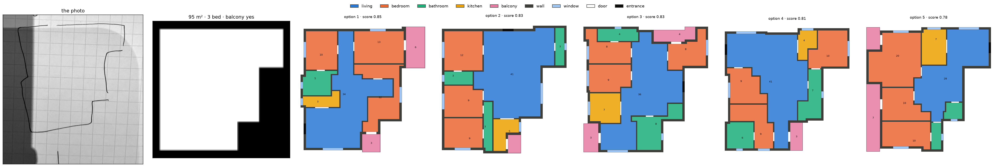

[Generated layout in the app](04_final/proofs/5_layout_option_public.png) · [Saved layout gallery](04_final/proofs/6_gallery_public.png)

### Sketcheat screenshots

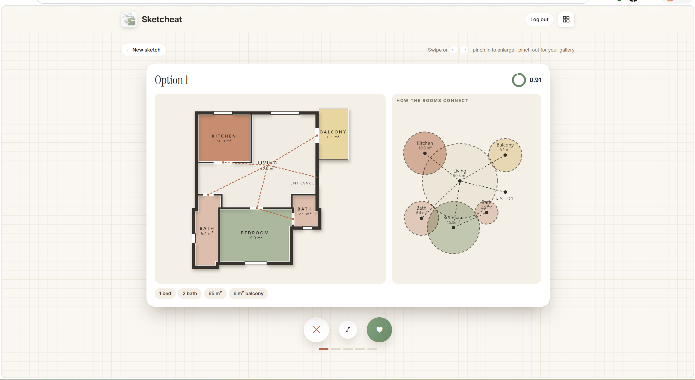

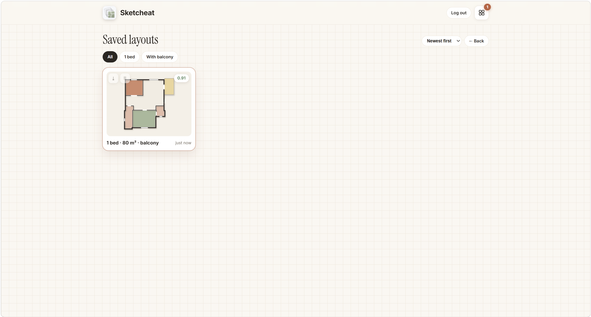

IAAC MaAI – AI Methods hackathon, 16–20 November 2026.

## Team

- Team 4: Fawad, Hetashree, Daria, Luis

## Links

| Part | Where |
|---|---|
| Autoencoder (Monday) | [`01_autoencoder/`](01_autoencoder/) · model on Hugging Face: https://huggingface.co/iaac-maai/hackathon-team4-resplan-ae |
| Layout server, our model (Tuesday) | [`02_server/`](02_server/) · live: https://team4-layout-server.onrender.com |
| Search server (Tuesday) | [`02_model_server/`](02_model_server/) · live: https://team4-resplan-server.onrender.com |
| App: page + API + database (Wednesday) | [`03_app/`](03_app/) · live: https://sketcheat-team4.pages.dev (create an account with email + password) |

## Model servers

We run **two** servers on Render (free plan, Frankfurt). Both are defined in [`render.yaml`](render.yaml).

| | Layout server: [`02_server/`](02_server/) | Search server: [`02_model_server/`](02_model_server/) |
|---|---|---|
| **What it does** | Generates new floor plans for a given flat outline | Finds existing ResPlan plans that match |
| **Input** | Photo of the flat's silhouette + area (m²), bedrooms, balcony yes/no | Bedrooms + floor area (sqft) |
| **Output** | 5 floor plans: rooms, walls, doors, windows (metres), PNG preview, DXF file | 6 plans: room counts, 8 × 8 relationship matrix, scores (circulation, daylight, cross-ventilation, dark rooms, missing door) |
| **Model** | **Our conditional VAE** trained on ResPlan (ONNX decoder) | No model: a filter on precomputed plan data. `/predict` there is the course's class example, kept as a placeholder |
| **Built with** | Starlette | Gradio |
| **API example** | [`02_server/call_api.ipynb`](02_server/call_api.ipynb) | [`02_model_server/call_api.ipynb`](02_model_server/call_api.ipynb) |

Free services sleep after 15 minutes without requests; the first call then takes about one minute.

## The model behind Sketcheat

The app's live layout server uses the **LayoutCVAE v2** artifact in `02_server/model/`: a 32-dimensional conditional VAE decoder that produces eight 128 × 128 maps (living room, bedroom, bathroom, kitchen, balcony, wall, door and window). The decoder is conditioned on the outline mask and the requested area, bedroom count and balcony setting.

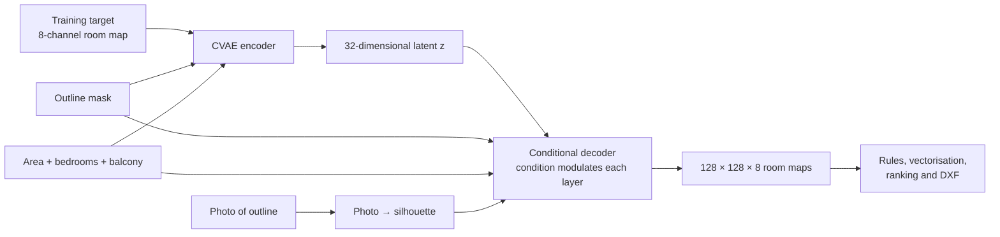

At inference, the server samples `z`, sends it with the silhouette and request conditions to the ONNX decoder, then converts and filters its maps into vector plans. The checked-in model configuration records **51 epochs** (best epoch **36**); the loss combines weighted binary cross-entropy, Dice and KL terms.

### Training and comparison evidence

The executed notebook `01_autoencoder/notebook/04_layout_generator.ipynb` contains the training curve for the earlier LayoutCVAE baseline. It is not the per-epoch history of the v2 artifact deployed by the server; that v2 training history is not included in this repository. The v2 configuration does record validation performance, so the results below distinguish the two sources rather than treating them as interchangeable.

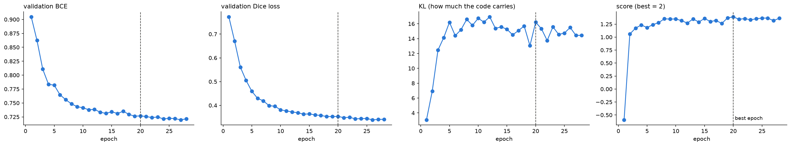

The executed baseline's three beta trials compared the same validation score and raw bedroom-count accuracy. The selected trial used β = 0.008.

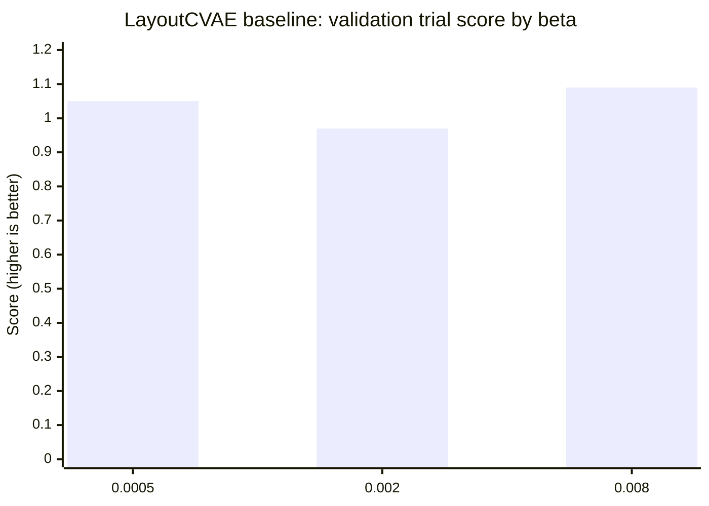

The deployed v2 artifact's saved validation checks report 46% exact bedroom-count agreement, 95% balcony agreement, 54% pixel difference between options, an average of 9.25 rule-usable maps per 30 generated, and five options for 92.5% of validation requests. These are validation checks, not held-out test-set scores.

### Recorded outline test and failure

The saved live-server API example in [`02_server/call_api.ipynb`](02_server/call_api.ipynb) requested a three-bedroom plan with a balcony. Across two rounds, the server generated 60 maps but only 4 passed its rules; it returned four ranked layouts with scores **0.87, 0.85, 0.84 and 0.84** instead of five. The other maps were rejected for bedroom count/size, balcony, kitchen or bathroom constraints. This is a single end-to-end example, not a held-out test-set aggregate; no broader test-outline score table is committed.

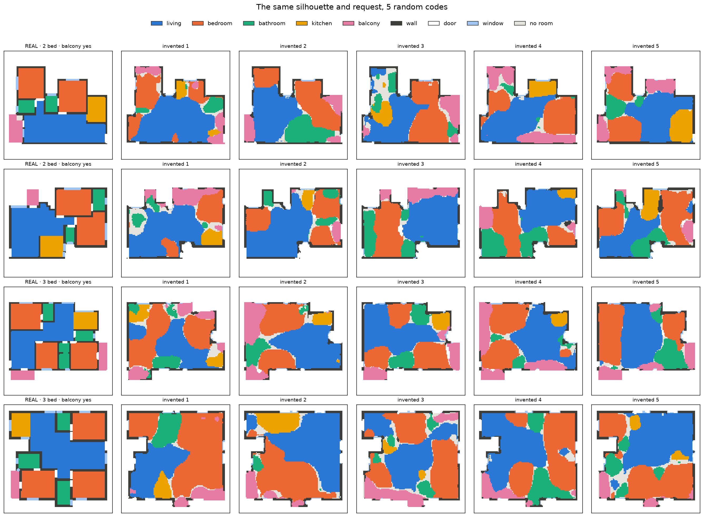

The filter can reject most generated maps, and some valid-looking candidates still have awkward room arrangements. The scores are ranking heuristics, not architectural compliance checks. Plans need professional review and are not guaranteed to satisfy building codes or functional requirements.

# ResPlan — Conditional Variational Autoencoder

## 1. Project Overview

This project explores the application of generative AI to residential floor-plan design using a Conditional Variational Autoencoder (CVAE).

The objective is to train a generative model that learns spatial patterns from residential floor plans and generates new floor-plan representations based on learned latent representations and numerical conditioning features.

The project uses the ResPlan dataset, containing approximately 17,000 residential floor plans represented through vector geometry and room connectivity information.

**Use case of the app: layout generator.** An architect draws the outline (silhouette) of a flat, takes a photo of it, and gives the area (m²), the number of bedrooms and balcony yes/no. Our model answers with **5 new floor plans** that fit inside the outline, with rooms, walls, doors and windows, as vectors in metres and as DXF files. See [section 6](#6-use-case-layout-generator).

Monday's use case was VAE latent interpolation (VAE blend) with a first CVAE; the sections 2 to 5 describe that first model.

## 2. Dataset

**Dataset:** ResPlan

**Dataset size:** Approximately 17,000 residential floor plans.

**Input representation:**
- 14 geometry channels.
- Raster resolution: 64 × 64 pixels.
- Three numerical conditioning features:
  - Net area
  - Area
  - Wall depth

The original floor-plan geometry is transformed into multi-channel raster representations for model training.

## Data

- **Dataset:** ResPlan, 17,000 residential floor plans (vector geometry, metric scale)
- **Source:** https://github.com/dariabasha/ResPlan (fork of the original ResPlan release)
- **Licence:** CC BY 4.0 for the data. Our code is MIT (see `LICENSE`).
- The data is **not** in this repository. Put `ResPlan.pkl` in the `data/` folder at the root.

The original dataset https://www.kaggle.com/datasets/resplan/resplan is not included in this repository.

## 3. Methodology

The project follows these stages:

1. Dataset inspection and preparation.
2. Geometry rasterisation into 14 channels.
3. Numerical feature preprocessing.
4. Training, validation and test splitting.
5. Conditional VAE architecture development.
6. Training and comparison of three latent configurations.
7. Reconstruction and latent-space interpolation.
8. ONNX model export and validation.

### Model architecture

The Conditional VAE consists of:
- An encoder that learns a compressed latent representation.
- A latent sampling mechanism.
- A decoder conditioned on numerical features.
- A reconstruction and KL-divergence loss.

The model receives a floor-plan representation and its numerical conditioning features and learns to reconstruct the input.

## 4. Experimental Configurations

Three configurations were trained using the same dataset split.

| Model | Latent Dimension | Parameters |
|---|---:|---:|
| CVAE_z32 | 32 | 1.92M |
| CVAE_z64 | 64 | 2.32M |
| CVAE_z128 | 128 | 3.11M |

### Model comparison

| Model | Training Time | Test Objective | Reconstruction Loss | KL Divergence |
|---|---:|---:|---:|
| CVAE_z32 | 205.52 | 205.51 | 7.21 |
| CVAE_z64 | 187.84 | 187.82 | 15.88 |
| CVAE_z128 | 196.96 | 196.94 | 22.79 |

Validation objectives and training times should be taken from the saved training histories.

### Results and interpretation

CVAE_z64 achieved the lowest reported test objective among the three configurations.

The results indicate that increasing latent dimensionality does not necessarily improve reconstruction performance.

The larger latent representation of CVAE_z128 did not produce a better test result than CVAE_z64.

Model selection is based on validation performance, while the test set is used for final evaluation.

## 5. Visual Results

### Dataset representation


### Training performance

**CVAE z32**

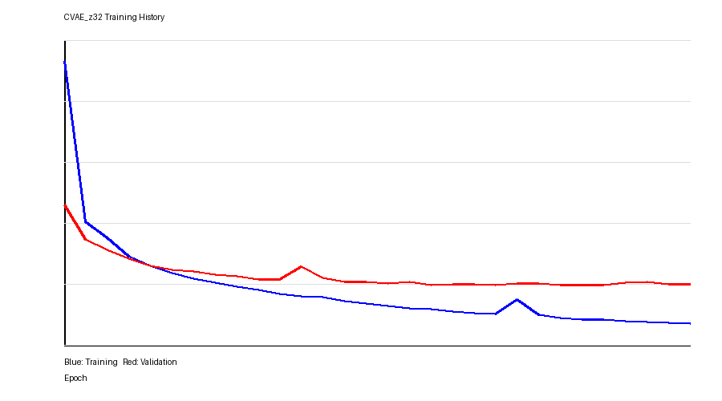

**CVAE z64**

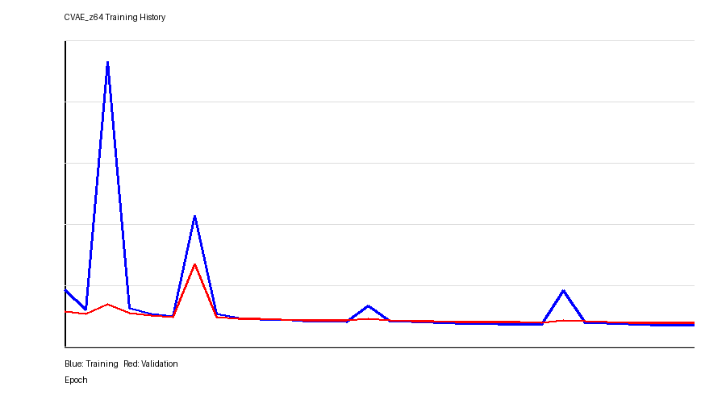

**CVAE z128**

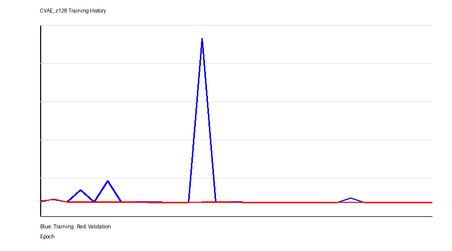

### Reconstruction

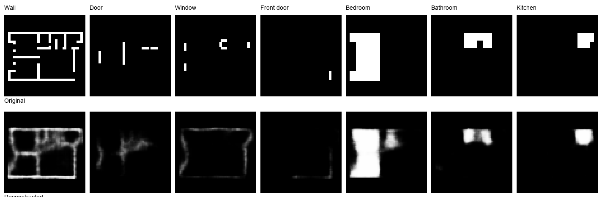

The model captures some room configurations and spatial patterns. However, reconstructed geometry remains blurry, and architectural details are not consistently preserved.

### Latent interpolation

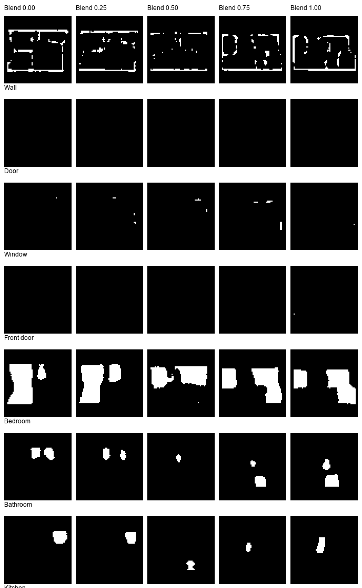

Latent interpolation explores transitions between learned floor-plan representations. This demonstrates the model's potential as a generative design exploration tool.

## 6. Use case: layout generator

**Who:** an architect at the start of a design. **Input:** a photo of the flat's silhouette, the area (m²), the number of bedrooms (1–5) and balcony yes/no. **Output:** 5 different floor plans that fit the silhouette, ranked by a score, with a PNG preview and a DXF file each.

How it works (notebooks [`04_layout_generator.ipynb`](01_autoencoder/notebook/04_layout_generator.ipynb) to [`06_photo_to_silhouette.ipynb`](01_autoencoder/notebook/06_photo_to_silhouette.ipynb), code in `layout_core.py`):

1. **Photo → silhouette:** the photo is turned into the outline of the flat.
2. **Model:** a second, conditional VAE (**LayoutCVAE**, latent size 32) trained on about 15,000 clean ResPlan plans. Its decoder gets a random code + the silhouette (seen at 8 to 128 px) + the request (bedrooms, balcony, area) and draws a 128 × 128 room map: living, bedroom, bathroom, kitchen, balcony, wall, door, window. Another random code gives another layout.
3. **Clean-up and choice:** the server draws 30 room maps, turns them into clean vector plans, drops the ones that break the rules (for example a bedroom under 9 m²), and keeps the 5 best that differ from each other.

The model runs as ONNX on the layout server: https://team4-layout-server.onrender.com ([`02_server/`](02_server/)).

**Limits:** the deployed v2 model's saved validation checks show the requested bedroom count exactly in 46% of raw maps and the balcony correctly in 95%. Cleanup rejects maps that fail rules; the recorded server example returned only 4 options after generating 60 maps. The plans are a starting point for the architect, not a checked design.

### Monday: VAE blend

Monday's use case explored interpolation between two learned floor-plan representations with the first CVAE.

Two floor plans are encoded into latent vectors. Intermediate latent representations are generated by interpolating between these vectors and passing them through the decoder.

This provides a way to explore variations in learned residential spatial configurations.

The output is a generated multi-channel floor-plan representation, not an editable CAD or BIM drawing.

## 7. Model Export and Deployment

The selected PyTorch model is exported to ONNX for portable inference.

The deployment files are stored in `model_app/`.

```text
model_app/
├── resplan_cvae.onnx
├── config.json
└── example_inputs/
    ├── floorplan_01.npy
    ├── floorplan_02.npy
    ├── floorplan_03.npy
    ├── condition_01.npy
    ├── condition_02.npy
    └── condition_03.npy
```

ONNX Runtime is used for model inference.

**Hugging Face model:** https://huggingface.co/iaac-maai/hackathon-team4-resplan-ae

## 8. How to Run

### Environment

The project uses Python and PyTorch.

Install the required packages using the project's environment configuration.

The main notebook is:

`notebook/02_autoencoder_clean_audited.ipynb`

Open the notebook in Jupyter or VS Code and execute its cells in order.

The notebook covers:
- Dataset preparation
- Model training
- Model evaluation
- Reconstruction
- Latent interpolation
- ONNX export and validation

The original dataset must be obtained separately.

## 9. Limitations

- Reconstructed floor plans are not consistently geometrically precise.
- Doors, windows and wall boundaries may be blurred or incomplete.
- Generated layouts are not guaranteed to satisfy architectural regulations or functional requirements.
- The output is a raster representation rather than editable CAD/BIM geometry.
- Further work is required to improve spatial consistency and architectural validity.

The model should therefore be considered an exploratory generative design tool rather than an automated architectural plan-production system.

## 10. Repository Structure

```text
01_autoencoder/
├── README.md
├── notebook/
│   └── autoencoder.ipynb
├── figures/
├── model_app/
│   ├── resplan_cvae.onnx
│   ├── config.json
│   └── example_inputs/
└── slides/
```

## 11. References and Links

- Dataset: https://www.kaggle.com/datasets/resplan/resplan
- GitHub repository: https://github.com/iaac-maai/hackathon-team4-resplan
- Hugging Face model: https://huggingface.co/iaac-maai/hackathon-team4-resplan-ae
- Layout server (our model): https://team4-layout-server.onrender.com
- Search server: https://team4-resplan-server.onrender.com

---

*IAAC Hackathon — Conditional Variational Autoencoder for Residential Floor Plans.*


## 12. AI usage disclosure

| | |
|---|---|
| **Tools** | ChatGPT, Claude |
| **Why** | To support understanding of the CVAE workflow, explore implementation approaches, troubleshoot code, interpret model results, and prepare the project documentation and submission materials. |
| **Where** | **Monday:** Claude created the initial empty repository structure, including folders, `.gitignore`, `LICENSE`, and the README template. ChatGPT supported understanding the assignment requirements, dataset structure, autoencoder concepts, and the CVAE implementation. **Tuesday–Thursday:** ChatGPT was used as a learning and development assistant to help with implementation questions, debugging, model evaluation, result interpretation, and preparation of documentation. |
| **How** | AI tools were used for explanations, coding assistance, troubleshooting, and documentation support. Suggested code and explanations were reviewed and adapted during implementation. Model training, experiments, evaluation, and final decisions were carried out as part of the team's project workflow. AI-generated suggestions were not treated as automatically correct; outputs were checked against the code, experiment results, and assignment requirements. |

**Lessons learned:** AI tools were useful for accelerating development and making unfamiliar concepts easier to understand. However, their suggestions still required verification. In particular, debugging, checking tensor dimensions, validating model outputs, and interpreting evaluation metrics required direct testing. We learned to use AI as an assistant for understanding and problem-solving rather than relying on it as a substitute for technical judgement.

## App and hand-in (Friday 10:00)

- App: https://sketcheat-team4.pages.dev (create an account with email + password; course test account details are distributed separately)
- Layout model server: https://team4-layout-server.onrender.com/health
- Search server: https://team4-resplan-server.onrender.com
- Hugging Face model (Monday autoencoder): https://huggingface.co/iaac-maai/hackathon-team4-resplan-ae
- Diagrams: [system](04_final/diagrams/1_system.md) · [user flow](04_final/diagrams/2_user_flow.md) · [sequences](04_final/diagrams/3_sequence.md) · [Wednesday diagrams and user stories](03_app/diagrams/)
- Proofs: [04_final/PROOFS.md](04_final/PROOFS.md)
- Privacy: https://sketcheat-team4.pages.dev/privacy.html
- Accounts: email + password via Supabase Auth; each user sees only their own designs ([proofs](04_final/PROOFS.md))

### What is clear

The model can turn a photographed outline and a small set of requirements into several editable vector-layout candidates. The rules and ranking make the output more usable, but do not replace architectural judgement.

### What is still unclear

We have not established how reliably the generator works across a broad, held-out set of unusual outlines, and a high ranking score does not tell us whether a plan is comfortable, accessible or code-compliant.

### What we would do next

We would publish and version the exact deployed layout model on Hugging Face, then evaluate it on a documented held-out set of varied outlines with architects reviewing the plans and the failure cases.

### Hosting status

The live server currently loads its ONNX artifact from `02_server/model/`; the layout ONNX has not yet been published to Hugging Face. The linked Hugging Face repository is the Monday autoencoder model, not the live layout model. Do not remove the checked-in ONNX or switch the server to a Hugging Face URL until the layout artifact has actually been uploaded and verified.